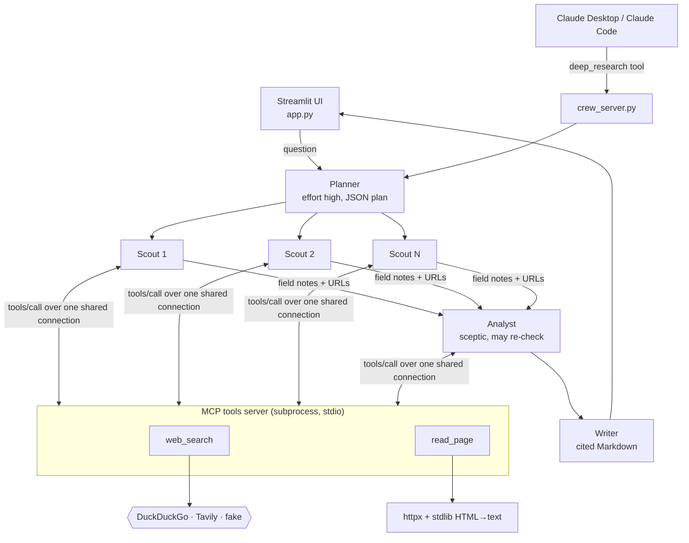

# DeepDive Research Crew

A team of Claude agents that researches a question on the web and writes a cited report. The agents reach the web only through an **MCP server**, and the finished crew is itself offered as an **MCP tool**, so Claude Desktop or Claude Code can call it.

There is no agent framework. The tool-use loop, the MCP-to-Claude bridge and the orchestration are all written by hand, about 400 lines in total, so every step can be read line by line. Every file is heavily commented to be walked through.

## The idea in one paragraph

A single agent with a search tool tends to follow the first thread it finds. Here a **planner** splits the question into a few independent angles. One **scout** per angle researches it in parallel, searching and reading real pages, and writes field notes in which every claim has a source URL. An **analyst** reads all the notes as a sceptic: it merges duplicates, flags single-source claims and decides which side of a contradiction the evidence favours. A **writer** turns that into the final report with numbered citations. All four roles are the same model with different instructions, different effort levels, and different access to tools.

## Architecture



The tools travel from MCP to Claude in three short translations, all done in [`mcp_bridge.py`](deepdive/mcp_bridge.py):

| From | To | What changes |
|------|----|--------------|
| MCP `Tool` | Claude tool definition | `input_schema` is copied across; both sides use JSON Schema |
| Claude `tool_use` block | MCP `call_tool(name, args)` | name and input are passed through as they are |
| MCP `CallToolResult` | Claude `tool_result` block | text blocks are joined; `is_error` is carried over |

## Code map: read in this order

| File | Role |
|------|------|
| [`deepdive/config.py`](deepdive/config.py) | Every knob: the model, effort per role, number of angles, tool budgets, depth presets |
| [`deepdive/web_tools.py`](deepdive/web_tools.py) | The raw abilities as plain Python: `search()` on three backends and `read_page()` with a stdlib HTML-to-text converter and a guard that blocks private URLs |
| [`deepdive/tools_server.py`](deepdive/tools_server.py) | Wraps those two functions as MCP tools with `MCPServer`. The docstrings are what the model reads. |
| [`deepdive/mcp_bridge.py`](deepdive/mcp_bridge.py) | Starts the tools server, lists its tools in Claude's format, runs calls, and logs them |
| [`deepdive/agent.py`](deepdive/agent.py) | **The core:** one `Agent` class and the hand-written tool-use loop with a turn budget |
| [`deepdive/crew.py`](deepdive/crew.py) | The four prompts and the orchestration: plan → parallel scouts → analyst → writer |
| [`app.py`](app.py) | Streamlit UI with live progress, the report, analyst view, scout notes and tool-call log |
| [`deepdive/crew_server.py`](deepdive/crew_server.py) | The crew offered as an MCP tool, `deep_research`, with progress notifications |
| [`tests/test_web_tools.py`](tests/test_web_tools.py) | HTML extraction, URL guard, offline backend |
| [`tests/test_mcp_tools.py`](tests/test_mcp_tools.py) | A real stdio MCP subprocess: discovery, calls, readable errors |
| [`tests/test_crew.py`](tests/test_crew.py) | The whole crew with a scripted fake Claude: plumbing, parallel tool results, budget, failure tolerance |
| [`tests/test_sdk_wire.py`](tests/test_sdk_wire.py) | The real Anthropic SDK against a mocked HTTP transport, checking the exact JSON sent to the API |

## Run it

Setup (once). Needs [uv](https://docs.astral.sh/uv/):

```bash
uv sync
```

```bash
cp .env.example .env
```

Then put your `ANTHROPIC_API_KEY` in `.env`. DuckDuckGo search is the default and needs no key.

Run the tests (offline, no keys, takes seconds):

```bash
uv run pytest
```

Launch the app:

```bash
uv run streamlit run app.py
```

Try the tools server on its own, for example with the MCP Inspector:

```bash
npx @modelcontextprotocol/inspector uv run python -m deepdive.tools_server
```

### Use the crew from Claude Desktop / Claude Code

Add this to the MCP servers config, using your absolute path:

```json
{
  "mcpServers": {
    "deepdive-crew": {
      "command": "uv",
      "args": ["--directory", "/ABSOLUTE/PATH/deepdive-research-crew", "run", "python", "-m", "deepdive.crew_server"],
      "env": { "ANTHROPIC_API_KEY": "sk-ant-...", "DEEPDIVE_SEARCH_BACKEND": "duckduckgo" }
    }
  }
}
```

### What a run costs

All agents use Claude Opus 5.5 (US$4 / US$20 per million input / output tokens). A "standard" run makes about 15 to 30 API calls, and scouts resend the pages they have read on every turn, so input tokens dominate the cost. The app shows an estimate after each run. "quick" depth is the cheap way to experiment.

## Where this differs from the reference project, and why

| Change | Why |
|--------|-----|
| No agent framework (the reference uses CrewAI) | The loop, the hand-offs and the context each agent sees are the point of the project, so they are written out instead of hidden. |
| Claude Opus 5.5 with adaptive thinking and an effort level per role, instead of DeepSeek R1 | One model plays every role. Effort is the dial: scouts run at `low` for many cheap tool rounds, while the planner and writer run at `high`. |
| MCP on **both** sides | The reference exposes the crew as an MCP server. Here the agents' own tools also sit behind MCP, so a search backend can be swapped without touching agent code. |
| Free DuckDuckGo search by default, Tavily optional, and an offline `fake` backend | It runs without a paid search key, and the offline backend makes the whole pipeline testable. |
| A separate analyst stage | Scouts are optimistic. A sceptic between research and writing catches single-source and contradictory claims before they reach the report. |
| Structured output for the plan | The planner's JSON is guaranteed by the API (`output_config.format`), so parsing the plan cannot fail. |
| Server-side refusal fallback (`fallbacks: "default"`) | If a safety classifier declines one call, the API retries on a fallback model instead of failing the run. |

## What was verified, and what wasn't

Verified on 2026-11-13, without a paid key:

- **12/12 tests pass** (`uv run pytest`). These cover the HTML extractor, the URL guard, a real stdio MCP subprocess, the full crew with a scripted Claude, and the real SDK serialising requests over a mocked HTTP transport: `thinking`, `output_config`, `fallbacks`, the beta header, and the thinking signature round-tripping unchanged.
- **Live DuckDuckGo search and page reading through the MCP subprocess**: real results, and a real page fetched and extracted.
- **The Streamlit app headless**: it renders, and clicking *Research* with a fake Claude runs the whole UI path (status log, metrics, four tabs, report) with no exceptions. `streamlit run` boots and passes its health check.

Not verified:

- **A real run against the Claude API**, which needs a paid key. The request shapes match the current docs and the SDK accepts them, but the live API has not yet seen them.
- **Tavily**: the code follows its REST API, but it was not run without a key.
- **`crew_server.py` inside Claude Desktop**: its tool listing was checked in-process, but it has not been driven from a real client.

## What I learned

- **mcp 2.x renamed `FastMCP` to `MCPServer`** (`from mcp.server.mcpserver import MCPServer`). It also added a high-level `mcp.Client` that accepts launch parameters, a URL, or a server object in the same process. That last option makes the tests easy.
- **Use `ToolError` for expected tool failures.** Any other exception reaches the model only as "Error executing tool X", which it cannot act on. With `ToolError` it sees "could not read URL: ...", and can try another source.
- **The stdio client does not pass on your environment.** The server subprocess gets a minimal, safe environment, so keys and settings it needs must be passed explicitly (`_PASS_THROUGH_ENV`).
- **Once a conversation contains tool calls, the tool definitions must stay in every request.** To make an agent stop at its budget, keep the tools and set `tool_choice: {"type": "none"}`.
- **Send the assistant turn back exactly as received.** Thinking blocks carry a signature, and the model needs them to continue the tool loop.
- **When Claude asks for several tools in one turn, return all the results in one user message**, each matched by `tool_use_id`. Running them with `asyncio.gather` makes a scout's three page reads take as long as the slowest one.
- **Many agents can share one MCP connection.** Each JSON-RPC message carries an id, so concurrent calls from parallel scouts don't get mixed up.
- **The Anthropic Python SDK 2.x runs on `httpx2`.** A mock transport for testing has to come from `httpx2`, not `httpx`.
- **Fakes that record requests must copy the arguments.** The agent appends to the same `messages` list after each call, so a recorded reference changes later. That caused my first two test failures.
- **Free search is flaky.** `ddgs` scrapes several engines, which sometimes rate-limit or return nothing, so one retry with a short backoff fixes most failures.

## Known limitations

- The stdlib HTML extractor drops `<nav>`, `<footer>` and similar tags, but on sites that build menus out of plain `<div>`s some menu text gets through. A readability library would do better at the cost of a dependency.
- PDFs are not read. `read_page` refuses non-text content types.
- The private-URL guard checks the URL before fetching; it does not re-check the target after a redirect.
